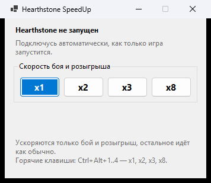

# Hearthstone SpeedUp

Ускоряет **бой в Полях сражений** и **проигрывание действий** в Hearthstone —
розыгрыш карт, атаки, срабатывания эффектов. Всё остальное идёт с обычной
скоростью: таблица соперников, существа в таверне, наведение на карты.

Скорости: **x1 · x2 · x3 · x8**. Подключается к игре сама.



> **Внимание.** Программа изменяет клиент игры. Правила Blizzard это
> запрещают, аккаунт может быть заблокирован. Используете на свой риск.

## Скачать и запустить

1. Откройте [Releases](https://github.com/PickaBoB/HearthstoneSpeedUp/releases/latest)
   и скачайте `HearthstoneSpeedUp-v….zip`.
2. Распакуйте в любую папку. Файлы `HearthstoneSpeedUp.exe` и
   `gsunity64.dll` должны лежать рядом.
3. Запустите `HearthstoneSpeedUp.exe` — до игры или после, неважно.
   .NET устанавливать не нужно, всё уже внутри.
4. Дождитесь надписи «Подключено» и выберите скорость.

Горячие клавиши (работают прямо из игры):

| Клавиши    | Скорость |
| ---------- | -------- |
| Ctrl+Alt+1 | x1       |
| Ctrl+Alt+2 | x2       |
| Ctrl+Alt+3 | x3       |
| Ctrl+Alt+4 | x8       |

Строка «Сейчас» в окне показывает текущую скорость игры и что происходит:
«идёт действие» — ускорено, «простой, x1» — обычная скорость.

## Частые вопросы

**Windows пишет «Система Windows защитила ваш компьютер».**
Программа не подписана сертификатом. Нажмите «Подробнее» → «Выполнить в
любом случае».

**Антивирус ругается или удаляет файл.**
Программа внедряет `gsunity64.dll` в процесс игры — антивирусы такое не
любят. Исходники открыты в этом репозитории, можно собрать самому
(см. ниже). Добавьте папку в исключения или не пользуйтесь.

**Пишет «Не удалось подключиться» или «Модули игры не читаются».**
Скорее всего, игра запущена от администратора. Запустите программу тоже от
администратора (правый клик → «Запуск от имени администратора»).

**Ускорение не включается.**
Перезапустите игру и программу. Если не помогло — приложите к
[issue](https://github.com/PickaBoB/HearthstoneSpeedUp/issues) лог
`%TEMP%\gsunity_<номер процесса>.log` (вставьте `%TEMP%` в адресную строку
проводника).

**После патча Hearthstone перестало работать.**
Программа опирается на внутренние классы игры. Если Blizzard их
переименует, ускоряться будет всё подряд или ничего — в окне это будет
видно, а лог скажет, что именно не нашлось. Нужно обновление программы.

**Что не ускоряется.**
Всё, что считает сервер: таймер хода, награды, поиск матча. Ускоряется
только то, что клиент показывает.

**Как выключить.**
Нажмите x1. Полностью модуль выгружается только перезапуском игры.

## Как это работает

Hearthstone написан на Unity и сам управляет скоростью через свой
`TimeScaleMgr`: итоговая скорость = скорость игры × множитель. Программа
внедряет в игру небольшой модуль (`gsunity64.dll`), который через встроенный
в игру Mono выставляет этот множитель. Поэтому собственное ускорение боя в
Полях сражений продолжает работать и просто умножается на выбранное.

Модуль каждые 40 мс смотрит, проигрывает ли клиент сейчас пачку действий с
сервера (`PowerProcessor.m_currentTaskList`) или идёт фаза боя
(`TB_BaconShop.m_gamePhase`). Только тогда множитель включается; ещё 0.6 с
после действия он держится, чтобы не мигать между соседними действиями.
Это чтение полей — игровой код из чужого потока не вызывается.

Подробно, со всеми ловушками и устройством: [docs/TECHNICAL.md](docs/TECHNICAL.md).

## Сборка из исходников

Нужны **.NET 8 SDK** и **Zig** (компилятор C, ~80 МБ):

```
winget install -e --id Microsoft.DotNet.SDK.8
winget install -e --id zig.zig
```

Сборка всего в `bin\`:

```
powershell -ExecutionPolicy Bypass -File build.ps1
```

Релизный архив, как в Releases (самодостаточный exe + DLL), в `dist\`:

```
powershell -ExecutionPolicy Bypass -File build.ps1 -Package -Version 1.0.0
```

Диагностика без внедрения — что видно про запущенную игру:

```
powershell -ExecutionPolicy Bypass -File diag.ps1 -Name Hearthstone
```

## Структура

```
src/hook/gsunity.c         модуль Unity: множитель через Mono/IL2CPP, режим Hearthstone
src/hook/gsphook.c         модуль часов ОС (для консольного режима, не для Hearthstone)
src/injector/              окно и консольный режим (WinForms, .NET 8)
src/testtarget/testclock.c тестовая мишень для модуля часов
package/README.txt         инструкция, которая кладётся в архив релиза
build.ps1                  сборка и упаковка
diag.ps1                   диагностика
docs/TECHNICAL.md          техническое описание
```

---

## English

Speeds up **Battlegrounds combat** and **played-out actions** (card plays,
attacks, triggers) in Hearthstone while the leaderboard, tavern minions and
card hovering keep their normal pace. Presets x1 / x2 / x3 / x8,
Ctrl+Alt+1..4 in game.

Download the zip from
[Releases](https://github.com/PickaBoB/HearthstoneSpeedUp/releases/latest),
unzip, keep `HearthstoneSpeedUp.exe` and `gsunity64.dll` together, run the
exe. It finds and attaches to Hearthstone by itself; no .NET install needed.

It injects a small module that sets the multiplier of the game's own
`TimeScaleMgr` through the embedded Mono runtime, only while the client is
playing out server actions or a Battlegrounds combat is on.

**This modifies the game client and breaks Blizzard's Terms of Use — your
account may be banned. Use at your own risk.**
